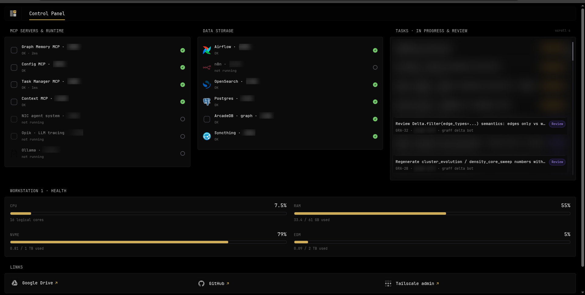

I run several projects in parallel, and most of the work is done by four different coding and research agents: Cursor, Codex, Antigravity and Grok Bot. Each is capable on its own. 
Here the problem appears - none of them knew what the others had decided yesterday, today etc. The fix was shared infrastructure: one graph memory, one task tracker and one source of rules, self-hosted on a single server and reached over MCP from several devices. This post covers the architecture.

Scope: it runs on subscriptions I already pay for. Paid APIs are optional and not covered here.

## The problem

With multiple projects and multiple agents:

- **Lost context.** Codex had no idea what Cursor and I had decided the day before and why. Anything settled with a cloud assistant stayed in that chat.
- **Instruction drift.** One repo had `AGENTS.md`, another `.cursorrules`, a third a pasted system prompt. The agents slowly started following different rules.
- **No visibility.** It was hard to tell what each agent was doing or where its results went.
- **Usage limits and tokens.** One agent could read the other agent's folder. It just takes too much effort, time, and tokens.

For me the agents have dedicated areas of work/responsibilities/abilities - Cursor for everyday coding, Antigravity (Gemini) for harder code and scientific work, Codex as the general default, Grok Bot as a bot, a companion, and for operations. This is why context has to live outside any one of them.

## Architecture

Codex, Antigravity and Cursor run on several of my devices, Grok Bot runs in the cloud. Everything they share lives on one server. Local agents reach it over Tailscale, or the LAN at home. Grok Bot also connects through Tailscale. Agents can also query OpenSearch, Postgres and ArcadeDB over forwarded ports, without an MCP layer. Google Drive is used as external storage. 

The shared services:

- **[Graph Memory MCP](https://github.com/river-ai-lab/graph-memory-mcp).** Long-term memory shared across agents, sessions and projects. This one is my own open source project.
- **Task Manager MCP.** Agents create, take and close tasks per project. It's also written by me and the agents, because my goal here was to implement some features specifically for me (like representation of tasks in graphs, and so on). There are a lot of alternatives, though, both cloud and OSS. One could simply use Notion, Jira, and so on.
- **Config MCP.** One source of rules for every agent. Change a rule once, every agent picks it up next session or by request.
- **Context MCP.** Assembles each agent's working context. In testing, also based on graphs.
- **NIC.** A multi-agent system I use for different jobs, and I stay in control of how a run goes. It can work on local models and through a harness. Agents don't call it. Opik traces the calls. It also has very specific features. But there are a lot of alternatives nowadays.
- **Data storage.** Airflow and n8n ingest into OpenSearch, Postgres and ArcadeDB, Syncthing handles file sync, S3 provides object storage. 

## A session

One loop, for working on tasks, can look like this. It isn't the only one.

1. `get_brief`: load what's done, decided and still open.
2. **Rules:** fetch current instructions from Config MCP.
3. `search`: check memory before doing or recording anything.
4. **Task:** take one from the tracker, or file one.
5. **Work:** code, analysis, tests; extra workers through NIC if the job splits.
6. **Record:** write facts and decisions back to memory; update the task.

Decisions and knowledge go into memory, so the other agents can see them. That matters when projects sit next to each other. Often the result comes back to me before the task is closed.

## Why a graph, not just vector RAG

Plain vector retrieval answers "what text looks similar to this query". Shared agent memory needs more: which decision replaced which, what contradicts what, which project a fact belongs to and which agent wrote it. Those are relationships, so memory is a graph where every node also carries an embedding. Similarity search finds the entry point; edges supply the context around it.

## Why ArcadeDB

I just looked for a native graph database that could write and read fast, deal with millions easily, and was modern. I found ArcadeDB and I like it. For me it is the way to go, though there are alternatives.

Trade-off: I don't know yet. The community is smaller, and working with a graph of a few billion records might be a problem. I'll find out soon on one of the projects.

## Guardrails

This started with a client whose cost-estimate documents etc must never leave their perimeter. Part of that work runs on local models, and checks sit wherever data could go out. The same approach went into NIC.

Guardrails inspect what goes out to cloud LLMs, as a cascade (this is the common practice):

- **Rules:** code logic and regular expressions.
- **NLP:** NER and other fast ML models.
- **Local LLM:** only for cases the first two layers can't settle.

Cheap checks run first, so most traffic never touches the LLM. The action on a hit is configurable per policy: pass, mask, replace with reversible placeholders, or block the request. Fail-closed mode (block when unsure) is available per policy but isn't the default.

Data storage, Opik and local models are self-hosted, so their data stays inside.

## Known weak spots

The setup assumes the one trusts LLM providers: code, tasks and memory pass through their models. Beyond that:

- **Memory and task poisoning.** Agents read what other agents wrote. A fact carrying injected instructions, from a bad web page or a compromised agent, reaches every agent that searches for it. `created_by` helps trace it, not prevent it.
- **Config MCP is a single point of trust.** Right now whoever can write to it changes every agent's instructions at once.
- **Guardrails can be missed.** Encoded data, or data split across several requests, can get through a check that looks at one request. Anything that talks to a cloud model without NIC isn't checked.
- **Opik keeps the raw prompts.** There is no other log. Those traces are the record, and they are also sensitive. Opik and its database have to stay closed.

## What is meh
- **The graph-memory-mcp GUI.** It works, but it's rough enough that I still mostly inspect memory through the agents.

## As a small conclusion

Everything here is still in testing, including Context MCP and the client setup that connects each agent to the same services.

A concrete case: over several evening sessions in Codex, the agent and I worked through a hard design problem, dropped most approaches and wrote a spec. Decisions, rejected options and reasons went into memory; the spec became tasks. Later I opened Cursor and just named the task. It pulled the brief, found the discussion, made some get_context calls, told me which approach we'd chosen and why the others were dropped, and started on the first task. No re-explaining.
